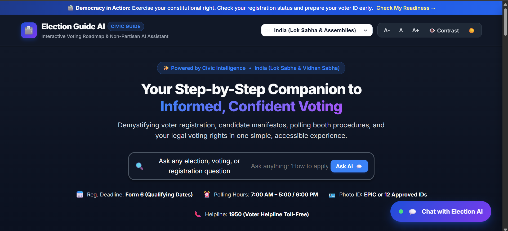
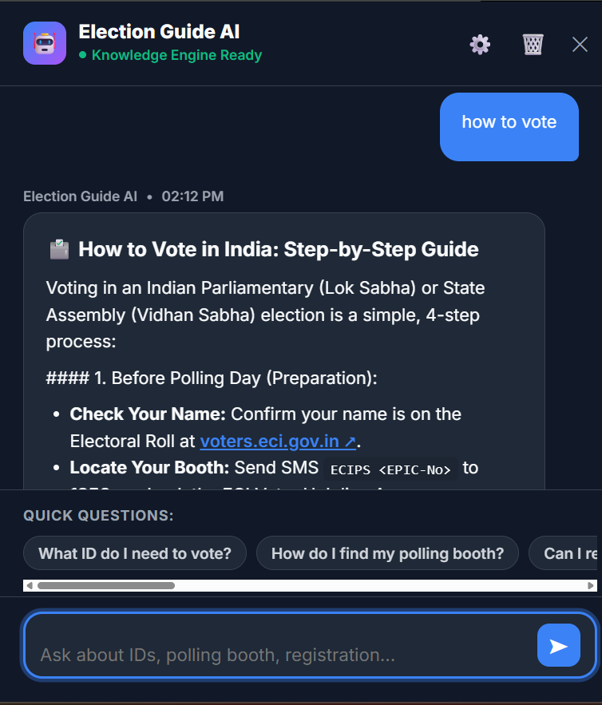

# 🗳️ Election Guide AI

An interactive web assistant that makes election processes easy to understand: voter registration, candidates, polling day, and results, explained step by step with an AI chat helper.

**🔗 Live demo:** https://jaishreejaiswal.github.io/election-guide-ai/




> Built using AI-assisted development (Google Antigravity). I designed the features and user flow, tested the app, and can explain how each part works.

---

## Why I built this

Many first-time voters find registration steps, eligibility rules and polling procedures confusing. I wanted one simple place where someone can learn the process and ask questions in plain language.

## Features

**Stage-based election timeline**
- Four phases: Registration → Candidates & Manifestos → Polling Day → Results
- Checklists per phase (progress saved in the browser) and FAQ accordions
- Jurisdiction presets: India, United States, and general democratic standards

**Search-to-chat assistant**
- Type a question in the main search bar and the chat drawer opens automatically
- Typing indicator animation (1–2 seconds), then the answer appears
- Chat auto-scrolls to the latest message
- Open-domain answers (not a fixed FAQ list), e.g. *"How do I apply for a Voter ID?"*, *"Rules for NRI voting"*, *"How do I check my name on the electoral roll?"*
- Read-aloud (text-to-speech) and copy buttons on messages

**Eligibility and readiness checker**
- 5 quick questions (age, registration, ID, polling booth, candidate research)
- Readiness score with a personalised action plan
- Printable Election Day checklist

**Accessibility options**
- High-contrast mode, adjustable font size, light/dark theme
- ARIA labels for screen readers

## Two AI modes

| Mode | How it works |
|------|--------------|
| Built-in engine | Works instantly, offline, using the bundled election knowledge base |
| Google Gemini (optional) | Paste your own free API key (from Google AI Studio) in the settings box. The key stays in your browser only |

## Tech stack

HTML5 · CSS3 · JavaScript (no frameworks) · Google Gemini API · Web Speech API · localStorage

## How to run

**Easiest:** open the live demo: https://jaishreejaiswal.github.io/election-guide-ai/

**Run it on your computer:**

1. Download or clone this repository
2. Open `index.html` in Chrome, Edge or Firefox

**Optional (Windows):** to run it on a local server, open PowerShell in the project folder and run:

`powershell -ExecutionPolicy Bypass -File .\serve.ps1`

Then open `http://localhost:8080/` in your browser.

## Project structure

```
election-guide-ai/
├── index.html         # Page layout
├── styles.css         # Styling, themes, print styles
├── election-data.js   # Election knowledge base and timeline data
├── ai-engine.js       # Offline engine + Gemini API integration + text-to-speech
├── app.js             # UI logic: stages, checklist, readiness score, search and chat
├── serve.ps1          # Simple local server
├── screenshots/       # App screenshots used in this README
│   ├── home.png
│   └── chat.png
└── README.md
```

## What I learned

- Structuring a multi-file front-end project
- Designing a chat interface (typing indicator, auto-scroll)
- Calling an external AI API from JavaScript
- Prompt design for an open-domain assistant
- Using Git and GitHub to publish a project

## Limitations and next steps

- Election rules change, so always confirm details on official sources (e.g. voters.eci.gov.in)
- Next: add more Indian state-specific information, and a backend so users never have to enter an API key themselves

## Author

**Jaishree Jaiswal** · [LinkedIn](https://www.linkedin.com/in/jaishree-jaiswal-9a71b0429) · [GitHub](https://github.com/jaishreejaiswal)
